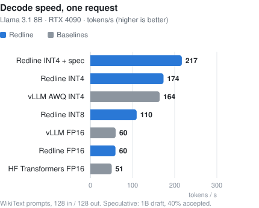
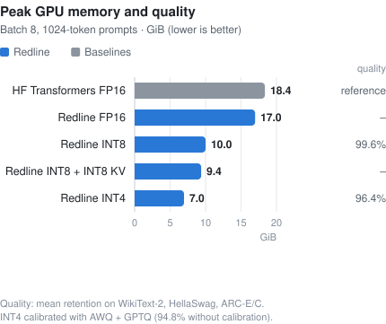
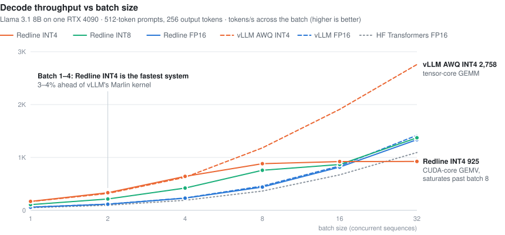

# Redline: Low-Latency CUDA Transformer Runtime

Redline is a C++/CUDA inference engine that serves Llama-family models on one GPU and owns the parts of the
decode path that frameworks usually hide: scheduling, KV-cache memory, kernels and sampling. A
continuous-batching scheduler mixes chunked prefill with decode every step, storing keys and values in a
paged KV cache (one GPU allocation cut into 16-token blocks) and preempting the newest request when memory
runs out. To keep the GPU busy, the host plans step *t+1* while step *t* is still running, uploads each
step's metadata in a single pinned-memory copy, replays decode steps as CUDA graphs, and samples tokens on
the GPU so they feed the next step without a round trip to the CPU. Because decode is memory-bound,
weights can be stored as INT8 or INT4 and dequantized in registers by custom GEMV kernels, attention reads
each K/V vector once per GQA group, and a small draft model can propose tokens that the target verifies
losslessly in one pass. A benchmark harness timed with CUDA events and NVTX runs identical workloads
through Redline, Hugging Face Transformers and vLLM, and reports time to first token, per-token latency,
throughput, peak memory and draft acceptance.

<p align="center">
  <picture>
    <source media="(prefers-color-scheme: dark)" srcset="docs/img/decode_batch1-dark.svg">
    
  </picture>
  <picture>
    <source media="(prefers-color-scheme: dark)" srcset="docs/img/memory_quality-dark.svg">
    
  </picture>
</p>
<p align="center">
  <picture>
    <source media="(prefers-color-scheme: dark)" srcset="docs/img/batch_sweep-dark.svg">
    
  </picture>
</p>

<sub>Measured on one RTX 4090 with Llama 3.1 8B Instruct (Llama 3.2 1B draft). Every system ran the same
workload files. Full methodology and raw data: [`results/rtx4090/`](results/rtx4090/README.md). The charts
are generated from that data by `python scripts/plot_results.py`.</sub>

## Run the interactive tour locally

The tour is one self-contained HTML page. It needs only Python 3.8+, no GPU and no dependencies:

```bash
git clone https://github.com/neil456/redline.git && cd redline
python3 demo/open_demo.py            # opens demo/index.html in your browser
python3 demo/open_demo.py --serve    # or serve it at http://localhost:8000
```

It walks through one decode step with a live figure for each idea:
- async scheduling and CUDA graphs;
- the paged KV cache and the scheduler;
- bytes moved per token for FP16, INT8 and INT4;
- speculative decoding.

It also includes the measured RTX 4090 results, three recorded engine traces, and a code map that points
at the source. [`docs/WALKTHROUGH.md`](docs/WALKTHROUGH.md) is the talk track for presenting it.

Supported models: `LlamaForCausalLM` (Llama 2/3/3.1/3.2, TinyLlama),
`MistralForCausalLM`, `Qwen2ForCausalLM` — FP16 activations, head_dim 64/128,
any GQA ratio up to 8.

```
                    host (one step ahead of the GPU)                         GPU stream
 ┌───────────────┐   ┌───────────────┐   ┌──────────────────────┐   ┌────────────────────────────────────┐
 │ Scheduler     │──▶│ BatchBuilder  │──▶│ pinned staging ring  │──▶│ 1 H2D memcpy of all step metadata  │
 │ continuous    │   │ ids/positions │   │ (8 slots, events)    │   │ CUDA graph (decode) or eager:      │
 │ batching,     │   │ KV slots,     │   └──────────────────────┘   │  embed → [RMSNorm → QKV GEMM →     │
 │ chunked       │   │ block tables, │                              │  RoPE+paged-KV write → attention → │
 │ prefill,      │   │ attn work     │   ┌──────────────────────┐   │  O GEMM → RMSNorm → gate/up GEMM → │
 │ preemption    │   │ lists, params │◀──│ pinned token outputs │◀──│  SwiGLU → down GEMM] × L → lm_head │
 └───────────────┘   └───────────────┘   │ (D2H, one step lag)  │   │ GPU sampling → ids feed next step  │
                                         └──────────────────────┘   └────────────────────────────────────┘
```

## What is implemented

| Area | Where | Notes |
|---|---|---|
| **Engine & scheduling** | `src/cuda/engine/engine.*`, `src/core/scheduler.*` | Continuous batching, chunked prefill mixed with decode, FCFS admission with KV watermark, recompute preemption, stop tokens / length limits |
| **GPU KV-cache management** | `src/cuda/model/kv_cache.*`, `src/core/block_allocator.*` | Paged KV cache in one GPU allocation; host block allocator with LIFO reuse; FP16 or INT8 (per-token, per-head scales) KV |
| **Async decode** | `Engine::step`, `upload_batch`, `launch_step` | Host plans and launches step *t+1* before reading step *t*'s tokens. Sampled ids feed the next step on the device. All metadata goes up in one async H2D copy from pinned memory. Sampled ids come back via a small D2H copy into pinned memory |
| **Reusable device buffers** | `MemoryLedger`, `LlamaModel` | Every buffer is allocated at init and accounted for by category; nothing is allocated on the decode path. Activation buffers are aliased across layer phases |
| **CUDA graphs** | `Engine::capture_graphs` | Decode graphs per batch-size bucket (padding writes to a scratch KV block). Draft-model rounds are captured per (bucket, round) |
| **Attention kernels** | `src/cuda/kernels/attention.cu` | Paged decode attention with flash-decoding split-K. All query heads of a GQA group share each K/V load, which cuts KV-cache traffic by the group factor. Tiled causal prefill attention over the paged cache with online softmax |
| **Weight-only quantized GEMV** | `src/cuda/kernels/gemv_weight_only.cu` | W8A16 (per-channel) and W4A16 (group-wise, asymmetric) decode kernels: 16-byte weight loads, dequantized in registers, fp32 accumulate. Chunked for batches up to 32. The INT4 gate/up projection has a fused SwiGLU output mode: gate and up rows are interleaved at load time, so the batch-1 MLP never writes the 2×-wide intermediate |
| **Tensor-core INT4 GEMM** | `src/cuda/kernels/gemm_w4a16_tc.cu`, `src/core/int4_layout.*` | W4A16 on `mma.sync.m16n8k16` for 1–64 rows. Weights are re-laid out at load so each lane's 16-byte load is exactly its B fragments for eight n8 tiles. Nibbles become fp16 with one `lop3` plus the `0x6400` exponent trick, then one `hfma2` applies the group scale and offset. Software-pipelined weight prefetch. Deterministic split-K (the last CTA reduces in a fixed order), with a split count that depends only on the shape, so results are batch-invariant. The epilogue writes fp16, fp32 or fused SwiGLU. `--int4-kernel auto` uses the GEMV for ≤4 rows and tensor cores above |
| **Quantized GEMM backends** | `src/cuda/gemm/` | cuBLASLt FP16 (cached heuristics, bias epilogue), cuBLASLt **INT8 W8A8** (dynamic per-token activation quantization), **CUTLASS** FP16×INT8 mixed-input tensor-core GEMM, **TensorRT-LLM** `CutlassFpAIntBGemmRunner` (INT4/INT8 fine-grained) with weight re-layout and per-shape config profiling, plus a dequantize-then-cuBLASLt fallback |
| **Sampling** | `src/cuda/kernels/sampling.cu` | Greedy, temperature, top-k, top-p. Exact radix-select thresholds instead of a vocabulary sort, then a Gumbel-max draw with a Philox RNG keyed by (seed, position), so results don't depend on batching |
| **Speculative decoding** | `Engine::run_spec_step`, `speculative_verify` | Draft model proposes *k* tokens and the target verifies them in one pass. Rejection sampling on the GPU is lossless (exact for greedy). Reports acceptance rate |
| **Benchmark harness** | `src/cuda/bench/harness.*`, `apps/redline_bench.cpp` | TTFT, inter-token latency, TPOT, E2E, decode / prefill / output throughput, per-step GPU time (CUDA events), host overhead, peak VRAM, acceptance rate. NVTX ranges for Nsight Systems; `--trace-out` writes a step-by-step trace for the demo |
| **Conversion & quantization** | `python/redline/convert.py`, `quantize.py`, `calibrate.py` | Streams HF checkpoints into one `.rlm` (safetensors) file. INT8 per-channel / INT4 group-wise quantization with MSE clip search. Calibrated INT4 (`--method awq\|gptq\|awq_gptq`) quantizes layer by layer on C4 samples, feeding each layer's quantized output into the next. **AWQ** searches per-channel activation-aware scales and folds them into the preceding RMSNorm or projection. **GPTQ** quantizes column by column and pushes the rounding error onto the remaining columns through the inverse Hessian |
| **Per-op profiler** | `src/cuda/op_profiler.h`, `redline_bench --profile-ops` | CUDA-event marks between the ops of each forward pass. Reports ms per pass and share of GPU time per op (embed, QKV, RoPE+KV write, attention, O, norms, gate/up+SwiGLU, down, lm_head, sampling) |
| **Baselines & evaluation** | `python/redline/baselines/`, `eval_quality.py`, `workloads.py`, `suite.py`, `report.py` | Same workloads through HF Transformers and vLLM. Quality retention (perplexity + multiple-choice) vs FP16 HF. Reproducible workload grid (~150 workloads) |

## Results

Measured on an RTX 4090 (Runpod, 2026-10-14) with Llama 3.1 8B Instruct as the target and Llama 3.2 1B
Instruct as the draft. The baselines are Hugging Face Transformers and vLLM 0.31 on the same workload
files. The full write-up, with methodology, every table and the raw JSON, is in
[`results/rtx4090/`](results/rtx4090/README.md).

| | decode tok/s, batch 1 | decode tok/s, batch 8 | vs HF FP16 (decode, geomean)* | peak VRAM vs HF FP16 | quality retention |
|---|---:|---:|---:|---:|---:|
| HF Transformers FP16 | 50 | 364 | – | – | 100% (reference) |
| vLLM FP16 | 60 | 459 | +24% | (preallocated) | – |
| vLLM AWQ INT4 (Marlin) | 164 | 1181 | +206% | (preallocated) | – |
| **Redline FP16** | 58 | 439 | +20% | −1% | – |
| **Redline INT8 (W8A16)** | 108 | 758 | **+81%** | **−43%** | **99.6%** |
| **Redline INT4 (W4A16, g128)** | **169** | 883 | +119% | −62% | 94.8% |

\* Geometric mean over the batch-1–32 sweep (512 in / 256 out). Peak VRAM and quality come from the
WikiText-prompt suite and from WikiText-2 / HellaSwag / ARC.

- At batch 1, decode runs at 89% (FP16), 82% (INT8) and 73% (INT4) of the RTX 4090's memory bandwidth.
  Redline's INT4 GEMV is 3–4% faster than vLLM's Marlin kernel at batch 1–4.
- FP16 decode is on par with vLLM (−3% geomean). At batch 8 and above, Marlin's tensor-core INT4 GEMM wins
  clearly, and vLLM's prefill is about 4× faster at large batches. Both are listed under Limitations.
- All 24 GPU tests pass on the 4090. On a real 1B checkpoint, Redline FP16 reproduces Transformers'
  greedy output token for token, and on 8B the log-probabilities agree to 0.0024 (mean |Δ|).

Reproduce everything with `scripts/run_rtx4090.sh` (or `QUICK=1` for the small grid). It builds the
engine, converts the checkpoints, runs every Redline configuration and both baselines, evaluates quality,
and writes `runs/<timestamp>/REPORT.md`.

## Build

Requirements: CUDA 12.x (sm_80+, defaults to sm_89 / RTX 4090), CMake ≥ 3.22,
a C++17 compiler, Python ≥ 3.10 for the tooling.

```bash
cmake -S . -B build -DCMAKE_BUILD_TYPE=Release \
      -DREDLINE_WITH_CUTLASS=ON \        # optional: fetches CUTLASS v3.5.1 (or -DREDLINE_CUTLASS_DIR=...)
      -DREDLINE_BUILD_PYTHON=ON          # optional: pybind11 module redline._redline
cmake --build build -j
pip install -e .                         # python tooling (convert, workloads, baselines, eval)
```

| CMake option | Default | Effect |
|---|---|---|
| `REDLINE_BUILD_CUDA` | ON | OFF builds only the host components (format, scheduler, CPU reference) |
| `REDLINE_WITH_CUTLASS` | OFF | CUTLASS mixed-input INT8 GEMM backend |
| `REDLINE_WITH_TRTLLM` | OFF | TensorRT-LLM weight-only GEMM; set `REDLINE_TRTLLM_ROOT` (source tree) and `REDLINE_TRTLLM_LIB` (`libtensorrt_llm.so`) |
| `REDLINE_WITH_NVTX` | ON | NVTX ranges (header-only NVTX v3) |
| `CMAKE_CUDA_ARCHITECTURES` | 89 | e.g. `"80;86;89;90"` |

## Quickstart

```bash
# 1. Convert (FP16 / INT8 / INT4; quantization runs on GPU if available)
python -m redline.convert --model meta-llama/Llama-3.1-8B-Instruct --out llama-int4.rlm \
       --weights int4 --group-size 128 --lm-head int8
#    calibrated INT4 (a few minutes on one GPU): --method awq | gptq | awq_gptq [--calib-dataset c4]

# 2. Generate text (tokenization via the HF tokenizer recorded in the file)
python -m redline.generate --model llama-int4.rlm --chat --prompt "Explain paged attention briefly."

# 3. Raw token ids / scoring with the C++ CLI
build/redline_generate --model llama-int4.rlm --prompt-ids 128000,791,6864,315 --max-new-tokens 32
build/redline_generate --model llama-int4.rlm --score-ids 128000,791,6864,315,9822

# 4. Benchmark (synthetic batch of 8, 512-token prompts, 256 new tokens) under Nsight Systems
nsys profile -t cuda,nvtx -o redline build/redline_bench --model llama-int4.rlm \
       --synthetic 8,512,256 --max-seqs 8 --track-memory --out report.json

# 5. Speculative decoding with a small draft
build/redline_bench --model llama-int4.rlm --draft-model llama1b-int4.rlm --spec-tokens 4 \
       --workload workloads/offline_b1_in512_out256_greedy.json
```

Python, in process (needs `-DREDLINE_BUILD_PYTHON=ON`):

```python
from redline.runtime import Engine
eng = Engine("llama-int4.rlm", max_seqs=8, kv_dtype="int8")
out = eng.generate([[128000, 791, 6864, 315]], max_new_tokens=64, temperature=0.7, top_p=0.9)
lp = eng.score([128000, 791, 6864, 315, 9822])   # teacher-forced log-probs
print(eng.memory_report())
```

## Engine options

`redline_bench --help` lists them all. The main ones:

| Flag | Meaning |
|---|---|
| `--max-seqs N` | concurrent sequences (= CUDA graph bucket ceiling) |
| `--max-batched-tokens N` | per-step token budget; prefill is chunked to fit |
| `--kv-cache-tokens N` / `--gpu-memory-utilization F` | KV capacity: explicit (capped by the budget) or derived from free memory |
| `--kv-dtype fp16\|int8` | KV-cache precision |
| `--int8-gemm auto\|cutlass\|w8a8\|dequant\|trtllm`, `--int4-gemm auto\|dequant\|trtllm` | GEMM backend for batched (non-GEMV) quantized linears |
| `--int4-kernel auto\|tc\|gemv` | INT4 decode kernel: `auto` = GEMV when a step has ≤4 rows, tensor cores above; `gemv` = CUDA-core GEMV up to `--gemv-max-m` rows, then dequantize + cuBLASLt |
| `--gemv-max-m N` | rows served by the weight-only GEMV kernels (default 8) |
| `--draft-model PATH --spec-tokens K` | speculative decoding |
| `--no-cuda-graphs`, `--no-async`, `--no-mixed-batches` | ablations |
| `--nvtx-layers`, `--track-memory`, `--profile-ops` | profiling aids (`--profile-ops` prints a per-op GPU time table; it runs without graphs) |

## Benchmark methodology

* **Workloads** (`python -m redline.workloads suite`): an offline grid over
  prompt length {128, 512, 1024, 2048} × output length {128, 256, 512} ×
  batch size {1, 4, 8, 16, 32} × sampling {greedy, nucleus} (two static
  batches each), plus online workloads with Poisson arrivals at 1–16 req/s
  and mixed lengths. Prompts are real WikiText token sequences. Everything is
  seeded, and all three systems replay the same JSON files.
* **TTFT** = first token visible on the host − arrival. **ITL** = gaps
  between consecutive token arrivals on the host. **TPOT** = (last − first) /
  (n − 1).
* **Decode throughput**: Redline reports tokens per second over decode steps,
  using wall time and CUDA-event GPU time. `report.py` compares systems on an
  ITL basis (batch size × 1000 / ITL p50), so all three use one definition.
* **Peak VRAM** = device-wide used memory (`cudaMemGetInfo` / NVML), sampled
  during the run. Redline sizes its KV cache to the workload
  (`--kv-cache-tokens`). vLLM pre-allocates from `--gpu-memory-utilization`,
  so set that to the smallest value that serves the workload for a
  like-for-like comparison.
* **Quality retention** (`python -m redline.eval_quality`): WikiText-2
  perplexity, HellaSwag (acc_norm), ARC-Easy (acc) and ARC-Challenge
  (acc_norm). Each is scored with identical teacher-forced log-likelihoods
  for the FP16 HF model and for Redline builds. Retention = Redline / HF
  (perplexity inverted), averaged over tasks.

## Tests

| Suite | Runs where | What it checks |
|---|---|---|
| `build/redline_core_tests` | anywhere | JSON, safetensors, fp16 conversion, RoPE scaling, block allocator, scheduler (async pending tokens, chunked prefill, preemption, lookahead), batch metadata layout, quantizers, CPU reference model |
| `pytest tests/python` | anywhere (CPU torch) | Exporter → `.rlm` → C++ reference reproduces HF Transformers logits (Llama, tied embeddings, Qwen2 biases, llama3 RoPE scaling) and dequantized-HF logits for INT8/INT4 and for AWQ/GPTQ-calibrated INT4 (GPTQ beats round-to-nearest on output error, AWQ's scale folding is exact). Also covers workload reproducibility, metrics, report math and the suite runner |
| `build/redline_cuda_tests` | NVIDIA GPU | Kernels vs CPU (RMSNorm, SwiGLU, RoPE + paged KV write, decode/prefill/chunked attention for FP16/INT8 KV across head dims and GQA ratios, GEMV incl. fused SwiGLU, tensor-core INT4 GEMM incl. split-K and the fused epilogue, cuBLASLt, every LinearExecutor path). Sampling distributions vs exact warped distributions, lossless speculative verification. End-to-end engine vs the CPU reference in every mode (graphs/async/mixed, quantized weights, INT8 KV, preemption, speculative decoding, harness report, per-op profile, GEMV and tensor-core INT4 kernels agreeing) |

## Layout

```
src/core/      host-only: JSON, safetensors, model config, scheduler, block allocator, batch builder, workloads
src/cpu/       fp32 CPU reference model + random model generator (test oracle)
src/cuda/      kernels/, gemm/ (cuBLASLt, CUTLASS, TRT-LLM, dispatcher), model/ (weights, KV cache, Llama),
               engine/ (engine, device batch), bench/ (harness)
apps/          redline_generate, redline_bench, redline_ref (CPU reference CLI)
python/redline convert, quantize, calibrate, format, runtime, generate, workloads, suite, baselines/, eval_quality, report
tests/         cpp/ (host), cuda/ (GPU), python/
scripts/       run_rtx4090.sh
demo/          interactive tour (template.html + build_demo.py -> index.html)
docs/          WALKTHROUGH.md (interview talk track and file map)
```

## Limitations

* FP16 activations only (no BF16 path). Models that overflow in FP16 are not
  supported.
* Speculative decoding runs synchronously: the accepted count is needed before
  the next step is planned. The draft rounds are graph-captured, the
  verification pass runs eagerly.
* Prefill attention uses CUDA cores (tiled, O(L) memory). A tensor-core flash-attention kernel is the
  main missing piece for TTFT.
* INT4 decode beyond batch 8 runs the W4A16 GEMV on CUDA cores (16 rows per pass) and stops scaling: at
  batch 32 it is 3× slower than vLLM's Marlin tensor-core kernel (measured, see `results/rtx4090`).
  Larger INT4 GEMMs use dequantize + cuBLASLt unless the TensorRT-LLM backend is built. The TensorRT-LLM
  adapter compiles against the v0.16 headers but needs `libtensorrt_llm.so` to link, and it has not been
  benchmarked.
* Prefill is about 4× slower than vLLM at batch 32 × 512 tokens (TTFT 1.0 s vs 0.23 s).
